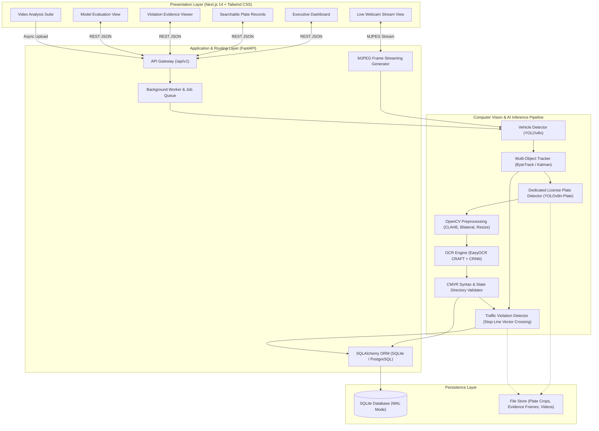
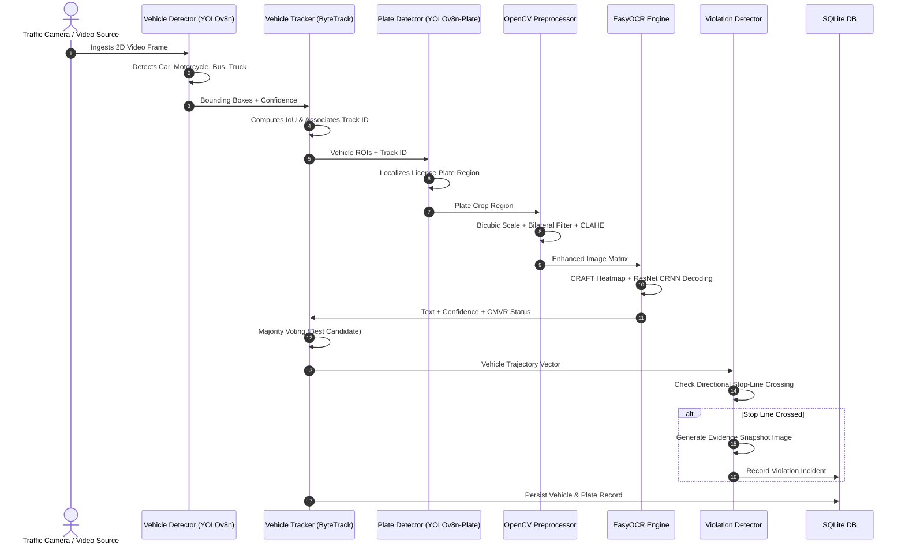
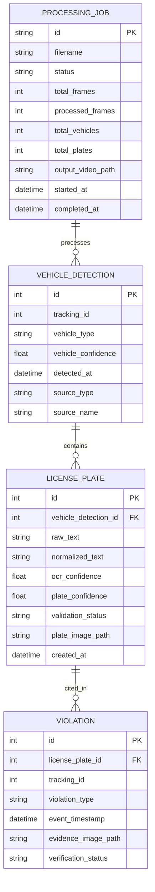

# System Workflow & Architecture Diagrams
## AI-Powered Automatic Number Plate Recognition (ANPR) System

---

## 1. Multi-Tier System Architecture

---

## 2. Computer Vision Pipeline Data Flow Diagram (DFD Level-1)

---

## 3. Entity-Relationship (ER) Database Diagram

